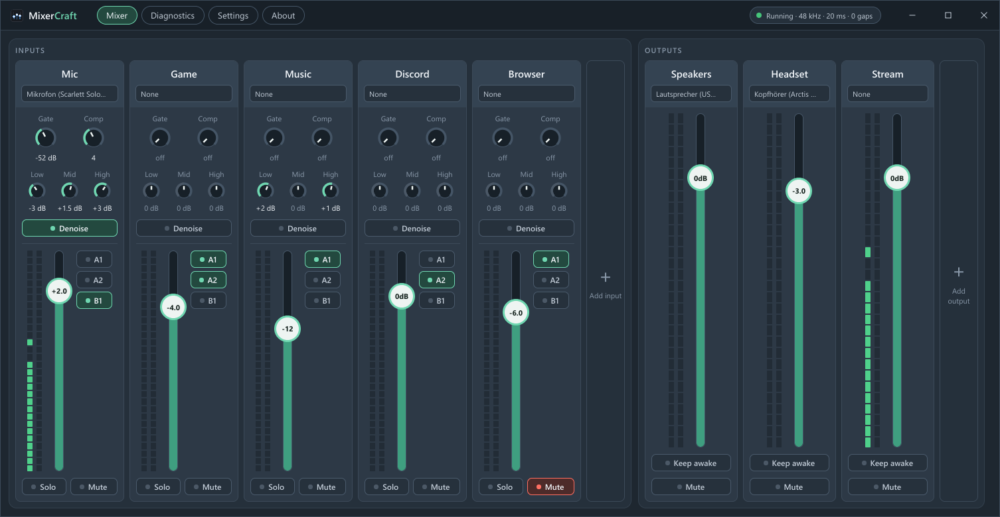
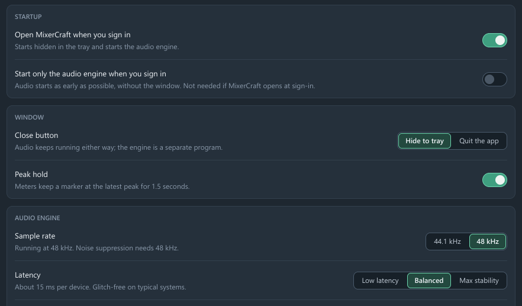
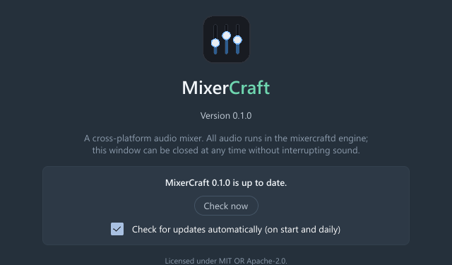
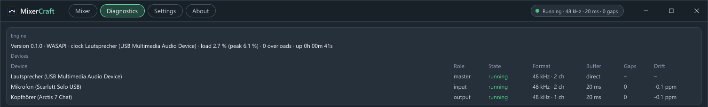

<div align="center">

<h1>&nbsp;MixerCraft</h1>

**A lightweight virtual audio mixer for Windows, written in Rust.**

Mix microphones, speakers, headsets and virtual devices on input strips and output buses,
with per-strip gate, compressor, EQ and noise suppression. Starts in a fraction of a second
and keeps running cleanly for days.

[](https://github.com/JustinSchweiger/MixerCraft/actions/workflows/ci.yml)
[](https://github.com/JustinSchweiger/MixerCraft/releases/latest)
[](https://github.com/JustinSchweiger/MixerCraft/releases)
[](#license)


[Download](https://github.com/JustinSchweiger/MixerCraft/releases/latest) ·
[Features](#features) ·
[Install](#install) ·
[Docs](#documentation) ·
[Build](#build-from-source)



</div>

> [!NOTE]
> MixerCraft is an independent alternative to VB-Audio Voicemeeter. It is not affiliated with
> VB-Audio and uses none of its code.

## Features

|  |  |
|---|---|
| 🎚️ **Mixer** | Any number of input strips and output buses, faders, mute, solo, routing buttons and live meters with peak hold |
| 🎛️ **Strip effects** | Gate, compressor and 3-band EQ per input, with knobs |
| 🗣️ **Noise suppression** | RNNoise per input strip removes background noise from voice |
| 🔌 **Virtual devices** | Playback and recording devices that apps can use, via the free [usbip-win2](https://github.com/vadimgrn/usbip-win2/releases) driver |
| ⏱️ **Clock drift handling** | Every device runs through a drift-compensated resampler, so independent hardware clocks never drain or overflow a buffer |
| 🛟 **Automatic recovery** | Unplugged or failing devices are reopened; a watchdog and adaptive buffers catch stalls, and every event is logged |
| ⚡ **Fast and separate** | The audio engine (`mixercraftd`) starts in about 0.2 s and runs without the window: closing or restarting the app never interrupts audio |
| 🔈 **Keep awake** | A short, very quiet pulse every few minutes of silence stops speakers with auto-standby from switching off |
| 🖥️ **Tray and sign-in** | Lives in the system tray, opens at sign-in if you want, one instance only |
| 🔄 **Updates** | Checks for new versions and installs them when you click *Download and install* |
| ⌨️ **Command line** | `mixercraft` controls every fader, route and device from a terminal or script |

## Screenshots

<table>
  <tr>
    <td width="50%"><br><sub><b>Settings</b>: sign-in start, window behaviour, sample rate and latency</sub></td>
    <td width="50%"><br><sub><b>Updates</b>: checked on start and daily, installed on your click</sub></td>
  </tr>
  <tr>
    <td colspan="2"><br><sub><b>Diagnostics</b>: engine load, device states, buffers, gaps and clock drift</sub></td>
  </tr>
</table>

## Install

Download **`MixerCraft-<version>-x64.msi`** from the
**[latest release](https://github.com/JustinSchweiger/MixerCraft/releases/latest)** and run it
(Windows 10 or 11, x64).

- No administrator rights needed; it installs to `%LOCALAPPDATA%\Programs\MixerCraft`.
- Options: desktop shortcut, start with Windows (in the tray), `mixercraft` on your `PATH`.
- The installer is not code-signed yet. If SmartScreen warns, choose **More info → Run anyway**.
- Updates keep your configuration (`%APPDATA%\MixerCraft`); uninstalling keeps it too.

**Virtual devices** need [usbip-win2](https://github.com/vadimgrn/usbip-win2/releases), which you
install yourself; the installer tells you if it is missing. They add about 95 ms between two
applications. Without usbip-win2 MixerCraft works with your physical devices.

### Linux and macOS (preview)

These builds are tested in CI (and Linux in WSL2), not yet on real Linux or Mac hardware.

- **Debian/Ubuntu** (x86_64, ARM64): `sudo apt install ./mixercraft_<version>_amd64.deb`
  (or `_arm64.deb`). **Other distributions:** unpack `mixercraft-<version>-linux-<arch>.tar.gz` and
  run `./install.sh` (installs to `~/.local`, no root; `./install.sh --uninstall` removes it).
  Needs glibc 2.36 and the PipeWire library 0.3.49 or newer (Debian 12, Ubuntu 24.04, Fedora 37
  and later). **Virtual devices** are PipeWire devices ("MixerCraft <name>" in your sound
  settings); no driver needed.
- **macOS 11+** (Apple silicon and Intel): open `MixerCraft-<version>-macos-universal.dmg` and drag
  MixerCraft into Applications. The app is not notarized (no paid Apple developer account): on the
  first start macOS blocks it; open **System Settings → Privacy & Security** and click **Open
  Anyway**. Allow microphone access when asked. No virtual devices on macOS yet.
- Updates: the app tells you about new versions and links to the release page; install the new
  package the same way.

## Documentation

| Guide | Topic |
|---|---|
| [releasing.md](docs/development/releasing.md) | Building the installers and packages, publishing a release |
| [testing-linux-macos.md](docs/development/testing-linux-macos.md) | Checklist for the first runs on Linux and Mac hardware |
| [building.md](docs/development/building.md) | Building from source on each platform |
| [overview.md](docs/architecture/overview.md) | How the engine, IPC and app fit together |
| [virtual-devices.md](docs/architecture/virtual-devices.md) | How virtual devices work |
| [feature-matrix.md](docs/feature-matrix.md) | What is supported and verified on which platform |
| [ADRs](docs/adr/README.md) | Architecture decisions |

## Build from source

Requires Rust 1.95 or newer.

```sh
cargo run --release -p mixercraft-gui     # the app; starts the engine if it is not running
cargo run --release -p mixercraft-cli -- status
cargo test --workspace
```

Windows installer: `powershell -ExecutionPolicy Bypass -File scripts\build-installer.ps1`
(needs the .NET SDK); Linux packages: `scripts/package-linux.sh`; macOS disk image:
`scripts/package-macos.sh` (see [releasing.md](docs/development/releasing.md)).

<details>
<summary><b>Command line examples</b></summary>

```sh
mixercraft status                  # engine, devices, strips and buses
mixercraft gain 0 -6               # strip 0 to -6 dB
mixercraft route 0 1 on            # strip 0 to bus 1
mixercraft source 2 virtual:Game   # apps playing to "Game" come in on strip 2
mixercraft fx 0 --denoise on       # noise suppression on strip 0
mixercraft update                  # check for a new version
```

`mixercraft --help` lists everything.
</details>

<details>
<summary><b>Project layout</b></summary>

```
crates/
  mixercraft-core/      real-time engine: mixer, resampler, drift control, effects (no OS code)
  mixercraft-denoise/   RNNoise port used for noise suppression
  mixercraft-platform/  audio devices (cpal), virtual devices, autostart
  mixercraft-usbip/     USB/IP server emulating USB audio devices
  mixercraft-winaudio/  Windows default-device handling
  mixercraft-engine/    mixercraftd: supervisor, recovery, clocks
  mixercraft-ipc/       protocol between engine, app and CLI
  mixercraft-config/    configuration file and migrations
  mixercraft-update/    update checks, download and verification
  mixercraft-gui/       the app (Slint)
  mixercraft-cli/       the mixercraft command
installer/windows/      WiX installer
docs/                   architecture, decisions, guides
```
</details>

## License

Licensed under either of [MIT](LICENSE-MIT) or [Apache-2.0](LICENSE-APACHE), at your option.
The GUI is built with [Slint](https://slint.dev) under its royalty-free license.

“Voicemeeter” is a trademark of VB-Audio Software and is mentioned here only for description.
